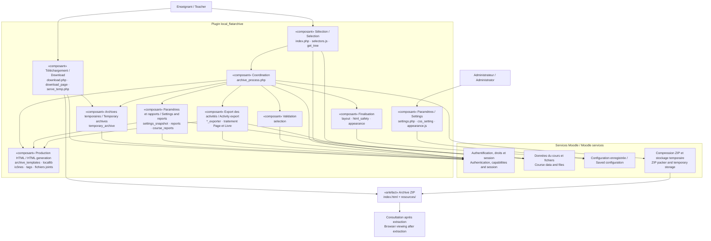
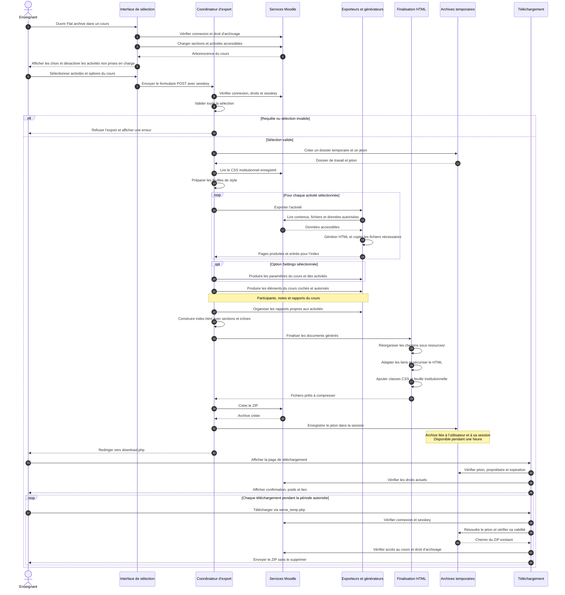

# Diagrammes UML — Flat Archive

[README français](../README.fr.md) · [English README](../README.md) · [Architecture détaillée / Detailed architecture](ARCHITECTURE.md)

Ces vues décrivent le code **0.2.0, build 2026101407**, base de préparation de la bêta. Les composants proches sont regroupés pour faciliter la lecture ; ils ne représentent pas des services déployés séparément. Les diagrammes Mermaid sont affichables directement sur GitHub et leurs sources restent modifiables dans ce fichier.

These diagrams describe **0.2.0, build 2026101407**, the baseline for beta preparation. Related components are grouped for readability; they are not independently deployed services. GitHub renders the Mermaid diagrams directly from this editable Markdown file.

## 1. Composants / Components

La vue de composants UML est représentée avec la syntaxe de graphe Mermaid et le stéréotype « composant » : il s’agit d’une vue architecturale simplifiée, pas d’une notation UML complète des ports et interfaces. Les flèches indiquent une utilisation, une dépendance ou le parcours de l’artefact.

The component view uses Mermaid flowchart syntax and component stereotypes, rather than full UML port/interface notation. Arrows represent usage, dependencies or the artifact's path.

`archive_process.php` coordonne la génération. Les exporteurs connaissent la structure et les règles d’accès de chaque activité. Page et Livre sont encore traités directement dans le coordinateur. Les modèles communs produisent les pages ; la finalisation adapte les chemins, applique les protections HTML et ajoute les classes `flatarchive-*` et le lien vers le CSS institutionnel. `appearance::write()` prépare cette feuille de style au début de l’export.

`archive_process.php` coordinates generation. Exporters handle each activity's structure and access rules; Page and Book are still handled directly in the coordinator. Shared templates generate pages. Finalisation adapts paths, applies HTML protections and adds `flatarchive-*` classes and the institutional stylesheet link. `appearance::write()` prepares that stylesheet at the start of export.

Moodle est nécessaire à la génération, mais pas à la consultation des pages exportées. Les liens et médias distants restent dépendants de leurs destinations. Les pièces jointes originales sont conservées ; elles ne bénéficient pas du nettoyage des pages générées.

Moodle is required for generation, not for viewing exported pages. External links and remote media still depend on their destinations. Original attachments are preserved and are not sanitised like generated pages.

## 2. Séquence / Sequence

Scénario principal : sélectionner le contenu, générer l’archive, puis télécharger le ZIP. Les participants représentent des groupes de fonctions du même plugin, pas des échanges réseau entre services indépendants.

Main scenario: select content, generate the archive and download the ZIP. Participants represent groups of functions within the plugin, not separate network services.

### Points de lecture / Reading notes

- **Génération synchrone :** l’export se déroule pendant la requête HTTP, sans file de tâches en arrière-plan. / **Synchronous generation:** export runs in the HTTP request, with no background job queue.
- **POST puis redirection GET :** la confirmation est séparée de la génération. Rafraîchir la page ou changer la langue ne crée pas une nouvelle archive. / **POST then GET redirect:** refreshing the confirmation page or changing its language does not regenerate the archive.
- **Sélection du cours :** décocher Settings exclut aussi les paramètres d’activité. Décocher les rapports du cours ne supprime pas les rapports des activités sélectionnées. / **Course options:** deselecting Settings also excludes activity settings; deselecting course reports does not remove selected activities' reports.
- **Échec de génération :** une exception dans le bloc de génération entraîne la suppression du dossier de travail, puis la remontée de l’erreur. Cette branche d’erreur est omise du scénario principal pour garder le schéma lisible. / **Generation failure:** an exception in the generation block deletes the workspace and propagates the error; this path is omitted from the main diagram for readability.
- **Téléchargement :** le ZIP existant est réutilisable pendant une heure dans la session propriétaire. Un jeton invalide, expiré ou un fichier absent conduit à une page d’indisponibilité ; un défaut de droits bloque l’accès. Le nettoyage temporaire Moodle récupère ensuite les fichiers, sans garantir leur effacement physique à l’instant de l’expiration. / **Download:** the owner session can retrieve the same ZIP for one hour. Invalid or expired tokens and missing files produce an unavailable page; missing capabilities block access. Moodle subsequently reclaims temporary files, not necessarily at the exact expiry time.

## Repères dans le code / Code references

| Responsabilité / Responsibility | Source |
|---|---|
| Sélection et arborescence / Selection and course tree | [index.php](../index.php), [get_tree.php](../classes/external/get_tree.php), [selection.php](../classes/archive/selection.php) |
| Coordination / Coordination | [archive_process.php](../archive_process.php) |
| Paramètres et rapports / Settings and reports | [settings_snapshot.php](../classes/archive/settings_snapshot.php), [reports.php](../classes/archive/reports.php), [course_reports.php](../classes/archive/course_reports.php) |
| Finalisation / Finalisation | [layout.php](../classes/archive/layout.php), [html_safety.php](../classes/archive/html_safety.php), [appearance.php](../classes/archive/appearance.php) |
| Durée de vie et session / Lifetime and session | [temporary_archive.php](../classes/archive/temporary_archive.php) |
| Confirmation et téléchargement / Confirmation and download | [download.php](../download.php), [download_page.php](../classes/archive/download_page.php), [serve_temp.php](../serve_temp.php) |
